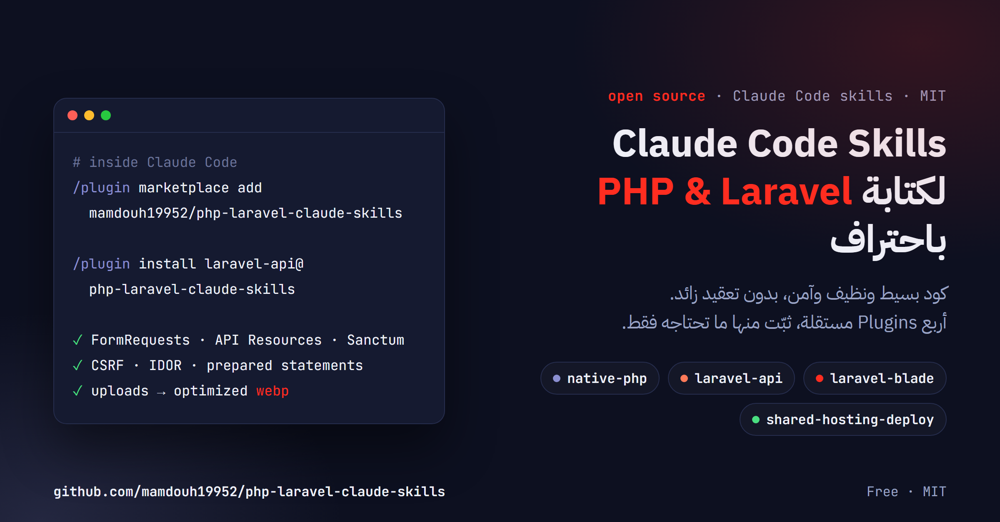

<p align="center">
  
</p>

<p align="center">
  <a href="LICENSE"></a>
  
  
  
</p>

<p align="center">
  <a href="#العربية">العربية</a> · <a href="#english">English</a>
</p>

---

<div dir="rtl">

<h2 id="العربية">العربية</h2>

مجموعة **Skills** لـ Claude Code تجعل كود PHP وLaravel الذي يكتبه Claude **بسيطًا ونظيفًا وآمنًا وسهل الصيانة**، وبأسلوب واحد ثابت في المشروع كله، دون تعقيد زائد (over-engineering).

### ماذا يتضمن؟

| Plugin | الاستخدام |
|---|---|
| **`laravel-blade`** | مشاريع Laravel التي تعرض صفحات Blade، مثل لوحات التحكم والمتاجر والأنظمة الإدارية، باستخدام Bootstrap وJavaScript بسيط وToastr. |
| **`laravel-api`** | واجهات REST API لتطبيقات الموبايل والـ SPA: صيغة JSON موحّدة، وFormRequests، وAPI Resources، ومصادقة Sanctum. |
| **`native-php`** | مواقع PHP وMySQL بسيطة بدون framework: استعلامات PDO مُجهّزة، وحماية CSRF، وجلسات آمنة، ورفع صور آمن. |
| **`shared-hosting-deploy`** | نشر مشاريع Laravel أو PHP على الاستضافات المشتركة (cPanel وHostinger hPanel) دون كشف ملف `.env`، مع حلول لأشهر المشكلات وقائمة فحص قبل الإطلاق. |

### التثبيت

داخل Claude Code، أضف الـ marketplace مرة واحدة:

</div>

```
/plugin marketplace add mamdouh19952/php-laravel-claude-skills
```

<div dir="rtl">

ثم ثبّت الـ Plugins التي تحتاجها فقط:

</div>

```
/plugin install laravel-blade@php-laravel-claude-skills
/plugin install laravel-api@php-laravel-claude-skills
/plugin install native-php@php-laravel-claude-skills
/plugin install shared-hosting-deploy@php-laravel-claude-skills
```

<div dir="rtl">

تعمل الـ Skills تلقائيًا عندما يتعلق طلبك بها، دون الحاجة إلى ذكر اسمها.

### أمثلة على الاستخدام

| الطلب | الـ Skill المستخدمة |
|---|---|
| «أنشئ CRUD للمنتجات مع الصور في لوحة التحكم» | `laravel-blade` |
| «أضف endpoint لحجز المقاعد في الفعاليات» | `laravel-api`، مع transaction وrow lock لمنع حجز المقعد نفسه مرتين |
| «أنشئ تطبيق مهام بسيطًا بـ PHP وMySQL مع تسجيل دخول» | `native-php` |
| «انشر المشروع على cPanel تحت example.com/app» | `shared-hosting-deploy` |

### المبادئ

- **البساطة أولًا:** يبقى المنطق في الـ controller، ولا يُضاف Service أو Repository إلا عند وجود سبب حقيقي، مع توضيح هذا السبب.
- **الأمان أساسي وليس اختياريًا:** تحقق من المدخلات على الخادم، وحماية CSRF في كل نموذج، وتقييد كل مستخدم ببياناته فقط (IDOR)، واستعلامات مُجهّزة دائمًا، وعدم عرض أي أسرار أو تفاصيل أخطاء للمستخدم.
- **تحسين الصور:** عند رفع المستخدم صورًا تُعرض في الموقع، تُحفظ بصيغة WebP بحجم صغير وجودة جيدة.
- **دعم العربية والاتجاه من اليمين إلى اليسار (RTL):** للمشاريع العربية أو الإنجليزية أو ثنائية اللغة.
- **المراجع الرسمية:** عندما يحتاج الطلب شيئًا لا تغطيه الـ Skill، يرجع Claude إلى توثيق Laravel أو PHP الرسمي للإصدار المستخدم في مشروعك، بدلًا من الاعتماد على الذاكرة.

### التحديث

</div>

```
/plugin marketplace update php-laravel-claude-skills
```

<div dir="rtl">

### المساهمة

الاقتراحات والتحسينات مرحّب بها عبر Issues أو Pull Requests.

### الترخيص

مرخّص بموجب [MIT](LICENSE)، ويمكنك استخدامه وتعديله بحرية.

</div>

---

<h2 id="english">English</h2>

A set of **Skills** for Claude Code that make the PHP and Laravel code Claude writes **simple, clean, secure, and easy to maintain**, in one consistent style across the whole project, with no over-engineering.

### What's included

| Plugin | Use it for |
|---|---|
| **`laravel-blade`** | Server-rendered Laravel apps such as admin panels, stores, and business systems, built with Blade, Bootstrap, vanilla JavaScript, and Toastr. |
| **`laravel-api`** | REST APIs for mobile apps and SPAs: a single JSON response envelope, FormRequests, API Resources, and Sanctum authentication. |
| **`native-php`** | Simple PHP + MySQL sites without a framework: PDO prepared statements, CSRF protection, secure sessions, and safe image uploads. |
| **`shared-hosting-deploy`** | Deploying Laravel or plain PHP to shared hosting (cPanel, Hostinger hPanel) without exposing `.env`, with fixes for the common traps and a pre-launch checklist. |

### Installation

Inside Claude Code, add the marketplace once:

```
/plugin marketplace add mamdouh19952/php-laravel-claude-skills
```

Then install only the plugins you need:

```
/plugin install laravel-blade@php-laravel-claude-skills
/plugin install laravel-api@php-laravel-claude-skills
/plugin install native-php@php-laravel-claude-skills
/plugin install shared-hosting-deploy@php-laravel-claude-skills
```

Skills activate automatically whenever your request matches them. There's no need to name them.

### Example prompts

| Prompt | Skill used |
|---|---|
| "Build a products CRUD with images in the admin panel" | `laravel-blade` |
| "Add an endpoint to book seats for an event" | `laravel-api`, with a transaction and a row lock so a seat can't be sold twice |
| "Create a simple PHP + MySQL task app with login" | `native-php` |
| "Deploy this project to cPanel under example.com/app" | `shared-hosting-deploy` |

### Principles

- **Simplicity first:** logic lives in the controller. A Service or Repository is added only when there is a real reason, and the reason is stated.
- **Security is built in, not optional:** server-side validation, CSRF on every form, users restricted to their own records (IDOR), prepared statements everywhere, and no secrets or error details shown to users.
- **Image optimization:** user-uploaded images that appear on the site are stored as small, high-quality WebP files.
- **Arabic and RTL support:** for Arabic, English, or bilingual projects.
- **Official documentation:** when a request needs something a skill doesn't cover, Claude consults the official Laravel or PHP documentation for your project's version instead of relying on memory.

### Updating

```
/plugin marketplace update php-laravel-claude-skills
```

### Contributing

Suggestions and improvements are welcome through Issues and Pull Requests.

### License

Released under the [MIT License](LICENSE). You're free to use and modify it.
